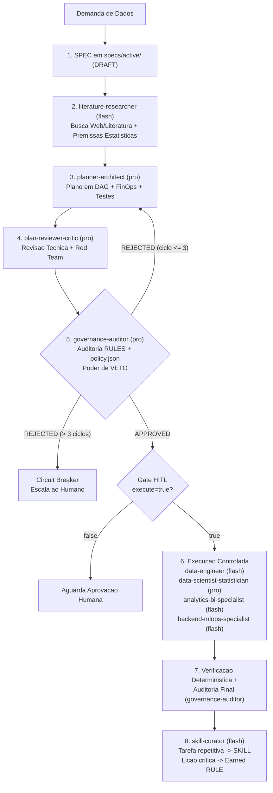

# AnalyticsAgent — Template Aberto (MIT) de Repositório Agêntico Multi-Cloud para Produtos de Dados

[](./LICENSE)

Um **harness agêntico** nativo para **Google Antigravity**, licenciado sob **MIT** e estruturado como **repositório template aberto** para construção de **Produtos de Dados** em padrão de mercado (**Python `src`-layout + `pyproject.toml`/`uv` + Cookiecutter Data Science v2 + Open Data Contract Standard ODCS v3.x + Power BI `.pbip`/TMDL/PBIR**), operando cooperativamente com **N agentes especializados** em **Azure (Microsoft Fabric)** e **AWS**.

---

## 1. Arquitetura e Fluxo Operacional

O repositório combina **Spec-Driven Development (SDD)**, **topologia Hub-and-Spoke** (evitando loops descontrolados entre agentes), **model tiering** para otimização de custos, **validação científica prévia na literatura**, **guardrails determinísticos via Hooks** e **evolução contínua (SKILLs e Earned RULES)**.



---

## 2. Estrutura de Diretórios (Harness Antigravity)

```text
AnalyticsAgent/
├── AGENTS.md                               # Regras raiz P0 (enxuto, sempre carregado, < 24KB)
├── README.md                               # Documentação geral da arquitetura
├── .agents/                                # Diretório nativo descoberto pelo Antigravity
│   ├── hooks.json                          # Hooks determinísticos (SessionStart, PreToolUse, PostToolUse, Stop)
│   ├── hooks/                              # Scripts Python stdlib dos hooks
│   │   ├── session_bootstrap.py            # Injeta contexto de SPECs ativas e candidatos a SKILL
│   │   ├── security_finops_gate.py         # Bloqueia comandos destrutivos, leaks de segredos e SELECT * sem limite
│   │   ├── telemetry_logger.py             # Grava eventos operacionais em ops/telemetry/events.jsonl
│   │   └── stop_gate.py                    # Registra encerramento de turno
│   ├── rules/                              # Catálogo modular de RULES (P0 Mandatory / P1 Important)
│   │   ├── 00-governance-and-security.md
│   │   ├── 01-plan-review-critique-loop.md
│   │   ├── 02-finops-and-cost-tiering.md
│   │   ├── 03-statistical-and-data-rigor.md
│   │   ├── 04-skill-and-rule-evolution.md
│   │   └── 05-mcp-auth-and-tls-runtime.md  # Earned Rule: MCPs, az/aws login, TLS corporativo, Python 3.11/3.12
│   ├── plugins/                            # Plugins nativos descobertos automaticamente
│   │   └── multicloud-mcp-connectors/
│   │       ├── plugin.json                 # Manifesto do plugin de conectividade
│   │       └── mcp_config.json             # fabric-mcp-server (npx) + aws-mcp (uvx) + powerbi-modeling-mcp (npx), zero segredos
│   ├── agents.json                         # Manifesto de descoberta Antigravity para os 5 diretórios de agentes
│   ├── agents/                             # Rede cooperativa de 22 agentes agrupados por domínio (hierarquia máx. 2 níveis)
│   │   ├── core/                           # orchestrator, planner-architect, plan-reviewer-critic, governance-auditor, literature-researcher, skill-curator
│   │   ├── data-science/                   # data-scientist-statistician (Manager) + ds-eda-diagnostics, ds-statistical-modeling, ds-feature-engineer, ds-ml-validation-calibration
│   │   ├── data-engineering/               # data-engineer (Manager) + de-ingestion-contracts, de-medallion-spark-sql, de-finops-performance
│   │   ├── analytics-bi/                   # analytics-bi-specialist (Manager) + bi-semantic-tmdl-modeler, bi-dax-performance-auditor, bi-kpi-reconciliation
│   │   └── backend-mlops/                  # backend-mlops-specialist (Manager) + mlops-serving-api-builder, mlops-registry-drift-monitor
│   ├── skills/                             # SKILLs com divulgação progressiva (Progressive Disclosure)
│   │   ├── spec-lifecycle/                 # CLI spec_cli.py (create/validate/transition/archive)
│   │   ├── skill-extractor/                # CLI scaffold_skill.py (extrai tarefas repetitivas)
│   │   ├── rule-promoter/                  # Promove Earned Rules e poda regras obsoletas
│   │   ├── ops-telemetry-auditor/          # CLI audit_metrics.py (KPIs de governança e erros)
│   │   ├── literature-premise-validator/   # Protocolo de busca e matriz de premissas
│   │   ├── fabric-onelake-ops/             # Padrões Fabric + MCP + runbook REST/SQL Endpoint (Python 3.12)
│   │   ├── aws-data-ops/                   # Padrões AWS S3/Iceberg/Glue/Athena + aws-mcp
│   │   ├── mlops-serving-ops/              # Padrões MLOps, Serving, Model Registry & Drift
│   │   ├── multicloud-mcp-runtime/         # CLI verify_mcp_env.py: diagnóstico read-only de MCP/Auth/TLS/Python
│   │   ├── powerbi-pbip-semantic-ops/      # CLI pbip_precheck.py: padrão .pbip/TMDL/PBIR, Power BI Desktop MCP e pré-check BPA/VertiPaq/DAX
│   │   ├── internal-knowledge-base/        # CLI knowledge_cli.py: índice SQLite FTS5 (BM25) sobre knowledge/
│   │   ├── adversarial-redteam-checklist/  # Protocolo Red Team (Carbon) para auditoria de planos
│   │   ├── finops-cost-estimator/          # CLI estimate_finops.py: estimativa Athena/Egress/Fabric CUs/Gemini 4
│   │   ├── statistical-diagnostics-runner/ # CLI run_diagnostics.py: testes estatísticos, PSI e Brier Score
│   │   ├── odcs-contract-validator/        # CLI validate_odcs.py: validação de contratos ODCS v3 e PII
│   │   ├── ml-leakage-and-oot-guard/       # CLI check_leakage.py: detector estático de data leakage e OOT
│   │   ├── tmdl-bulk-refactor/             # Refatoração em lote TMDL + pbip_precheck (Hydrogen)
│   │   ├── medallion-pipeline-scaffolder/  # CLI scaffold_pipeline.py: gera pipeline + contrato ODCS + pytest
│   │   ├── pdf-to-kb-distiller/            # Destilação rápida PDF (knowledge/inbox/) -> KB-NNN + FTS5
│   │   └── project-warmup/                 # Warmup leve de workspaces externos no Modo Plugin Global (zero cópia de .agents/)
│   └── workflows/                          # Orquestração executável via `run_workflow`
│       ├── data_task_orchestrator.py       # Pipeline Python completo com circuit breaker e tiering
│       └── workflow.json                   # Schema de argumentos validados
├── knowledge/                              # Base de Conhecimento Interna (PDFs + Notas Destiladas + FTS5)
│   ├── AGENTS.md                           # Precedência de conhecimento interno e citação obrigatória KB-NNN
│   ├── catalog.json                        # Catálogo versionado de fontes e notas
│   ├── inbox/                              # Entrada de novos PDFs para fichamento e indexação
│   ├── templates/knowledge-note.template.md
│   └── <dominios>/                         # data-science/, statistics/, data-engineering/, analytics-bi/, mlops-backend/
├── specs/                                  # Spec-Driven Development para Dados
│   ├── AGENTS.md                           # Regras locais de escopo para SPECs
│   ├── templates/                          # Templates padronizados (Engenharia, Ciência, Analytics, MLOps, Runtime)
│   ├── internal/                           # SPECs operacionais base (SPEC-000: MCPs Fabric/AWS; SPEC-000B: PBIP/TMDL + Power BI MCP)
│   ├── active/                             # SPECs em execução (contém SPEC-001 de exemplo)
│   └── archive/                            # SPECs concluídas (base para extração de SKILLs)
├── clouds/                                 # Regras hierárquicas por nuvem
│   ├── azure-fabric/AGENTS.md              # OneLake, Shortcuts S3 com Cache, V-Order, CUs, Entra ID, Purview
│   └── aws/AGENTS.md                       # S3 Lifecycle, Iceberg/Delta, Glue, Athena, IAM Least Privilege
├── ops/                                    # Governança determinística, telemetria e padrões
│   ├── governance/policy.json              # Denylists, padrões de segredos, PII, TLS e MCP
│   ├── telemetry/                          # events.jsonl e relatórios audit_report.json
│   └── patterns/repetitive_tasks_registry.json
├── contracts/                              # Open Data Contract Standard (ODCS v3.x)
│   └── templates/data-contract.odcs.yaml
├── data/                                   # Cookiecutter Data Science v2 (ephemeral, git-ignored)
│   ├── raw/ | interim/ | processed/ | external/
├── notebooks/                              # Apenas EDA exploratória (código produtivo vai para src/)
├── src/                                    # Padrão Python src-layout instalável via pyproject.toml + uv
│   ├── AGENTS.md
│   └── data_products/
│       ├── common/                         # RuntimeConfig segura (env + CA bundle, zero bypass TLS)
│       ├── harness/                        # CLI Dual-Mode analytics-agent-warmup (Plugin Global + init-workspace)
│       ├── engineering/                    # Pipelines Medallion Fabric & AWS
│       ├── science/                        # Estatística, diagnósticos & modelos OOT
│       ├── analytics/                      # Reconciliação Gold/Silver & projetos PBIP/TMDL/PBIR (pbip/)
│       └── mlops/                          # APIs de inferência, Model Registry & drift
├── scripts/                                # Atalho local scripts/warmup.py para instalação/pull do Plugin Global
├── tests/                                  # Suíte pytest (integridade do harness + Modo Dual + contratos + produtos)
├── .github/                                # CI GitHub Actions (ruff, pytest, SPEC, PBIP, KB) + templates PR/Issue
├── pyproject.toml                          # Manifest PEP 621 (hatchling, uv, ruff, pytest, Python 3.11–3.12)
├── .python-version                         # Fixa Python 3.12 (compatível com RULE-05)
├── .env.example                            # Variáveis não-sensíveis de referência (zero segredos)
├── LICENSE                                 # Licença MIT (pronto para GitHub Template Repository)
├── CONTRIBUTING.md                         # Guia de contribuição e sanitização
└── SECURITY.md                             # Política de segurança e divulgação responsável
```

---

## 3. Rede de Agentes e Otimização de Custos (Roteamento Gemini 4 + API Tiering)

| Agente | Papel | Modelo Gemini 4 (Antigravity / `/swarm`) | Tier API (`run_workflow`) | Modo | Poder / Limite Principal |
| :--- | :--- | :--- | :---: | :---: | :--- |
| `governance-auditor` | Segurança, Métricas & VETO | **Carbon** *(fallback: Neon XH / Argon)* | `pro` | `plan` | **VETO absoluto** contra violações de `RULES`/`policy.json` |
| `plan-reviewer-critic` | Revisão & Red Team | **Carbon** *(fallback: Neon XH / Argon)* | `pro` | `plan` | Classifica falhas (`BLOCKER`/`MAJOR`/`MINOR`) |
| `orchestrator` | Coordenação Hub-and-Spoke | **Neon (High)** *(fallback: Argon)* | `pro` | `default` | Gerencia ciclo da SPEC e circuit breaker (<= 3 ciclos) |
| `planner-architect` | Arquitetura & Plano DAG | **Neon (High)** *(escala p/ Carbon)* | `pro` | `plan` | Desenha solução multi-cloud e estimativa FinOps |
| `data-scientist-statistician` | Estatística & ML | **Neon (High)** *(escala p/ Carbon)* | `pro` | `default` | Diagnósticos obrigatórios antes de modelar; zero leakage |
| `backend-mlops-specialist` | Backend IA & MLOps | **Neon (Medium)** *(worker: Hydrogen)* | `flash` | `default` | APIs de inferência, Model Registry, CI/CD/CT, drift e rollback |
| `data-engineer` | Pipelines Fabric + AWS | **Hydrogen** *(escala p/ Neon Medium)* | `flash` | `default` | Só executa após `APPROVED`; foca em idempotência e FinOps |
| `analytics-bi-specialist` | Métricas & Direct Lake | **Hydrogen** *(escala p/ Neon Medium)* | `flash` | `default` | `.pbip`/TMDL/PBIR, Power BI MCP, pré-check BPA/VertiPaq |
| `literature-researcher` | Pesquisa `knowledge/` + Web | **Hydrogen** *(escala p/ Neon Low)* | `flash` | `plan` | Consulta `knowledge/` primeiro e define testes diagnósticos |
| `skill-curator` | Evolução de SKILLs/RULES | **Hydrogen** | `flash` | `default` | Extrai tarefas repetitivas (>= 2x), destila PDFs e poda regras |

### Hierarquia de 2 Níveis (Domain Managers → 12 Sub-Operadores Especializados)
Para máxima precisão com controle de custo (*Lazy Delegation* e profundidade máxima = 2 níveis; sub-operadores têm `can_spawn_subagents: false` e zero comunicação peer-to-peer):

| Domain Manager (Nível 1) | Sub-Operadores Leaf (Nível 2) | Modelo Gemini 4 | Especialidade Granular |
| :--- | :--- | :--- | :--- |
| **`data-scientist-statistician`** | `ds-eda-diagnostics` | **Hydrogen** | Profiling determinístico, nulos, outliers, colinearidade e PSI |
| | `ds-statistical-modeling` | **Neon (High)** / **Carbon** | Modelagem estatística/econométrica e análise de `summary()` (IC, VIF, resíduos, FDR, causalidade) |
| | `ds-feature-engineer` | **Neon (Medium)** | Features temporais sem *data leakage* e pipelines encapsulados |
| | `ds-ml-validation-calibration` | **Neon (High)** | Baseline vs. candidatos, validação OOT, PR-AUC/Lift e calibração (Brier/ECE) |
| **`data-engineer`** | `de-ingestion-contracts` | **Hydrogen** | Descoberta MCP, ingestão incremental, mascaramento PII e contratos ODCS v3 |
| | `de-medallion-spark-sql` | **Hydrogen** / **Neon Medium** | Transformações Bronze→Silver→Gold idempotentes (`MERGE`, V-Order, Iceberg) |
| | `de-finops-performance` | **Neon (Medium)** | Particionamento, *small files*, S3 Shortcut Cache, `EXPLAIN` e Fabric CUs |
| **`analytics-bi-specialist`** | `bi-semantic-tmdl-modeler` | **Hydrogen** | Star Schema em `.pbip`/TMDL/PBIR e `powerbi-modeling-mcp` |
| | `bi-dax-performance-auditor` | **Neon (Medium)** | Otimização DAX, `pbip_precheck.py`, BPA, VertiPaq, DAX Studio e Direct Lake |
| | `bi-kpi-reconciliation` | **Hydrogen** | Definição canônica de KPIs e reconciliação numérica Gold vs. Silver |
| **`backend-mlops-specialist`** | `mlops-serving-api-builder` | **Neon (Medium)** / **Hydrogen** | APIs FastAPI/Pydantic, Batch `PREDICT`/SageMaker, `/health` & `/ready` |
| | `mlops-registry-drift-monitor` | **Hydrogen** | Model Registry pinning, monitores de drift PSI/KS, SLO e rollout Shadow/Canary/Rollback |

> **Escalando para N Agentes:** Para adicionar um novo especialista (ex.: `fabric-capacity-tuner`, `causal-inference-specialist`, `data-secops-engineer`), crie `.agents/agents/<novo-agente>.md`, registre seu `modelTiering` em `ops/governance/policy.json` e inclua-o no `enum` de executores do `.agents/workflows/data_task_orchestrator.py`.

---

## 4. Como Operar no Antigravity (Modo Dual — Quick Start)

### Modo A — Instância Crua do Antigravity (Plugin Global + Pull/Warmup em 1 Comando, Zero Cópia!)
Para usar toda a rede de **22 agentes, 20 skills, regras P0, hooks e 3 MCPs** em **qualquer projeto** sem copiar `.agents/` para dentro de cada repositório:

```powershell
# 1) Pull + montagem do Plugin Global em ~/.gemini/config/plugins/analytics-agent/ + warmup read-only
uvx --python 3.12 --from git+https://github.com/Angelicogfa/AnalyticsAgent analytics-agent-warmup install

# (Ou a partir de um clone local deste repositório:)
uv run scripts/warmup.py install

# 2) Opcional: preparar apenas as pastas de trabalho num projeto externo (SEM copiar .agents/)
uvx --python 3.12 --from git+https://github.com/Angelicogfa/AnalyticsAgent analytics-agent-warmup init-workspace --workspace .

# 3) Checar status do plugin instalado
uvx --python 3.12 --from git+https://github.com/Angelicogfa/AnalyticsAgent analytics-agent-warmup status
```

> **Atualização contínua:** rode o comando `install` novamente para fazer `git pull` e atualizar o plugin global em todas as suas sessões do Antigravity. Os hooks respeitam automaticamente `ops/governance/policy.json` local do projeto (se existir) com fallback para a política empacotada no plugin (`PLUGIN_ROOT`), e gravam telemetria em `PLUGIN_DATA` sem poluir projetos externos.

### Modo B — Repositório Template (MIT) para Novo Produto de Dados
Clique em **Use this template** no GitHub para iniciar um repositório completo com `src/data_products/`, `contracts/`, `specs/`, `knowledge/`, `tests/` e CI verde.

### 1. Criar uma nova SPEC a partir de um template
```powershell
uv run .agents/skills/spec-lifecycle/scripts/spec_cli.py create --type science --slug previsao-demanda-skus --clouds aws,azure-fabric
```

### 2. Rodar o ciclo governado (Literatura → Plano → Revisão → Crítica → Auditoria)
Peça ao Antigravity para executar o workflow sobre a SPEC (por padrão com `execute: false` para aprovação humana antes da execução):
> *"Execute o workflow `.agents/workflows/data_task_orchestrator.py` para a SPEC `specs/active/SPEC-001-exemplo-cross-cloud-churn.md` com `execute=false`."*

Após revisar e aprovar o plano, reexecute com `execute=true`.

### 3. Metrificar operações e auditar governança
```powershell
uv run .agents/skills/ops-telemetry-auditor/scripts/audit_metrics.py --output ops/telemetry/audit_report.json
```

### 4. Extrair uma tarefa repetitiva em uma nova SKILL
```powershell
uv run .agents/skills/skill-extractor/scripts/scaffold_skill.py --name validar-contrato-delta --description "Valida schema, partições, taxa de nulos e ausência de PII em tabelas Delta/Iceberg antes de promover para Gold." --with-script --pattern-id PAT-001
```
